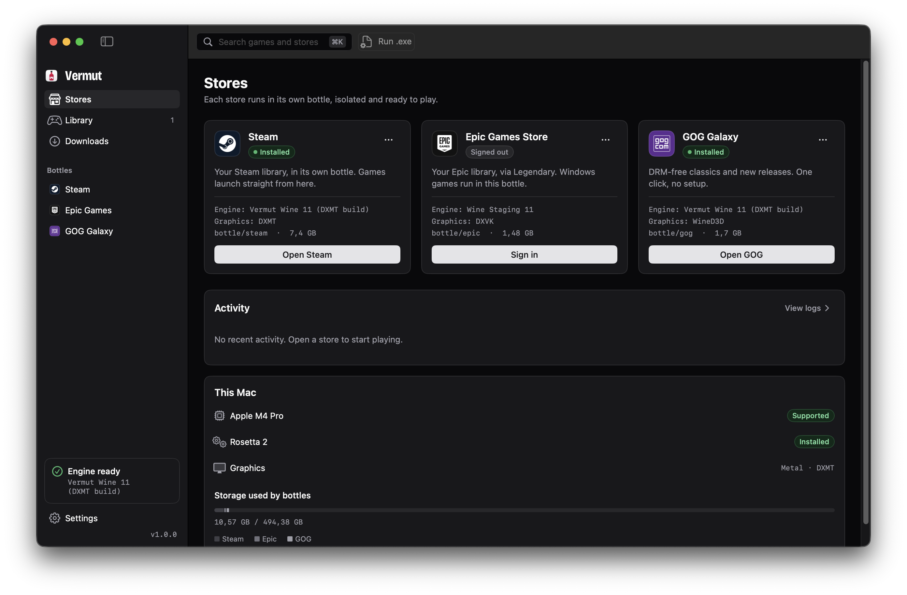
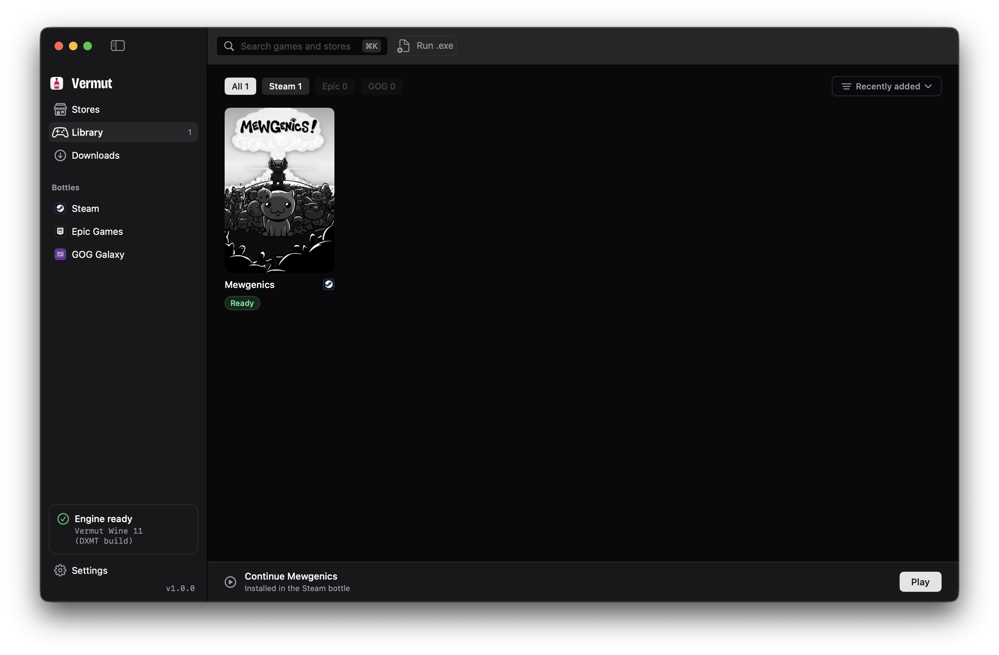
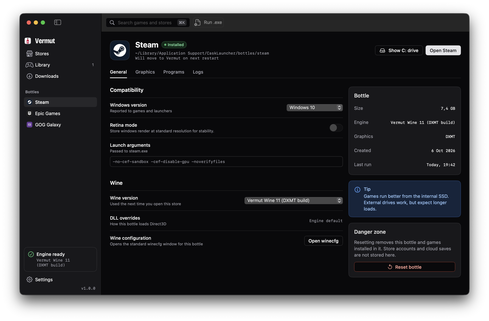

<p align="center">
  
</p>

<h1 align="center">Vermut</h1>

<p align="center"><strong>Pour. Click. Play.</strong></p>

<p align="center">
  A free, open-source way to run Windows game stores on Apple Silicon Macs.<br>
  Steam, GOG Galaxy, and Epic Games — via Legendary.
</p>

<p align="center">
  <a href="https://github.com/Contessafry/Vermut/releases"></a>
  <a href="LICENSE"></a>
  <a href="https://github.com/Contessafry/Vermut"></a>
</p>

Vermut is a native macOS app. It downloads a Wine 11 engine, gives each store its own bottle, and launches Windows games from a zinc-dark UI. There is no Vermut account, no telemetry, and no usage limit.

Epic Games is **beta**: login, library, install and launch go through [Legendary](https://github.com/derrod/legendary) (GPLv3), not the official Epic Games Launcher.

## Features

- **Steam** — downloads the official installer, sets up an isolated bottle, and launches Steam with a tested CEF recipe
- **GOG Galaxy** — official offline installer, WineD3D bottle
- **Epic Games (beta)** — native Legendary CLI, in-app sign-in, library covers, install into `drive_c/Games`, launch with Wine
- **Wine 11** — default **Vermut Wine 11 (DXMT build)** for DirectX 10/11 on Metal; Gcenx Wine Staging / Devel detected from GitHub releases (no hardcoded version)
- **Per-bottle graphics** — DXMT, DXVK + MoltenVK, WineD3D, or Apple D3DMetal if you already installed Game Porting Toolkit
- **Run a Windows `.exe` / `.msi` / `.bat`** from the toolbar
- **Library** — installed titles from Steam, GOG, and Epic
- **Diagnostics** — copy a redacted report for GitHub issues

## Screenshots

Drop PNGs into [`docs/screenshots/`](docs/screenshots/) (1280×800 window). Until then these links 404 on purpose.

<p>
  
</p>
<p>
  
</p>
<p>
  
</p>

## Requirements

- Apple Silicon Mac (M1 or later)
- macOS 14 Sonoma or later (`Package.swift` platforms `.macOS(.v14)`)
- Rosetta 2 (Vermut offers to install it on first launch)
- Several GB free for Wine, a store, and games
- A 1280×800 window is the default; the minimum is 1024×680

Intel Macs are not supported.

## Install

Recommended: paste this into Terminal.

```bash
curl -fsSL https://raw.githubusercontent.com/Contessafry/Vermut/main/install.sh | bash
```

It downloads the latest release, installs `Vermut.app` into `/Applications` and opens it. Files downloaded with `curl` don't get the `com.apple.quarantine` flag, so Gatekeeper doesn't block the unsigned app.

### Alternative: disk image

1. Download `Vermut-<version>.dmg` from [Releases](https://github.com/Contessafry/Vermut/releases).
2. Open the disk image and drag **Vermut** to **Applications**.

The app is **unsigned**. macOS Gatekeeper will block a double-click the first time.

- Open **System Settings → Privacy & Security** and click **Open Anyway**, or
- After copying it to Applications:

```bash
xattr -dr com.apple.quarantine /Applications/Vermut.app
```

On first launch Vermut downloads the Wine engine (about 1–2 GB) and can prompt for an admin password to install Rosetta 2.

## Build from source

You need Xcode or the Command Line Tools (`xcode-select --install`) on an Apple Silicon Mac.

```bash
git clone https://github.com/Contessafry/Vermut.git
cd Vermut
./build.sh
```

`./build.sh` runs the tests, builds an arm64 release, and writes `Vermut.app` in the repo root.

To cut a disk image (macOS only):

```bash
./scripts/make-dmg.sh
```

That produces `Vermut-<version>.dmg` with an Applications symlink and volume name **Vermut**.

Core tests also run on Linux with a Swift 6 toolchain (`swift test`). The SwiftUI app target is macOS-only.

## How it works

Vermut is not an emulator. [Wine](https://www.winehq.org/) (LGPL) translates Windows APIs to macOS. Each store lives in its own Wine prefix (“bottle”) under:

```
~/Library/Application Support/Vermut/
├── engines/     # Wine builds and the Legendary binary
├── bottles/     # steam, epic, gog — prefix, logs, bottle.json
└── cache/       # downloaded installers
```

Older builds used a different Application Support folder name; Vermut migrates it automatically when no Wine process is using those bottles.

| Engine | Role |
| --- | --- |
| **Vermut Wine** | Default. Wine 11 / CrossOver 26.3 LGPL build; `winemac` exports the Metal views DXMT needs. Source: [MartijnBud/grapple-releases](https://github.com/MartijnBud/grapple-releases). |
| **Wine Staging** | Latest Gcenx WineHQ build from [Gcenx/macOS_Wine_builds](https://github.com/Gcenx/macOS_Wine_builds) (auto-detected, not a pinned 11.18). Used automatically for DXVK bottles (Vermut Wine has no Vulkan loader). Requires system GStreamer.framework. |
| **Wine Devel** | Same Gcenx source, development branch, latest detected tag. Requires system GStreamer.framework. |

| Graphics | Notes |
| --- | --- |
| **DXMT** | DirectX 10/11 → Metal. Default for Steam and Epic. |
| **DXVK + MoltenVK** | DirectX → Vulkan → Metal. Optional. |
| **WineD3D** | DirectX → OpenGL. Required for GOG Galaxy (Qt software + GDI renderer). |
| **D3DMetal** | Apple GPTK, DirectX 12. **Not** downloaded. Enable it only if you installed GPTK yourself. |

Steam launches with `-no-cef-sandbox -cef-disable-gpu -noverifyfiles`. The Steam overlay is **off per game by default** (Game Settings toggle) because `gameoverlayrenderer` can hang titles on DXMT. Epic never runs the Windows Epic Games Launcher: Legendary talks to Epic on the host, then starts Windows game binaries inside the bottle.

Library tiles warn when Are We Anti-Cheat Yet? lists **Easy Anti-Cheat** or **BattlEye** for that Steam/Epic id. See [docs/ANTI_CHEAT.md](docs/ANTI_CHEAT.md). x86_64 emulation is Rosetta 2 by default; FEX is a Settings option that stays inactive until an ARM64 Wine + FEX runtime exists ([docs/FEX.md](docs/FEX.md)). GOG recipe: [docs/GOG.md](docs/GOG.md).

## Credits and licences

Vermut’s own source is MIT. It **downloads** the following as separate programs (not statically linked):

| Component | Licence | Source |
| --- | --- | --- |
| Wine / Vermut Wine 11 engine | LGPL 2.1+ | [Wine](https://www.winehq.org/), [grapple-releases](https://github.com/MartijnBud/grapple-releases), [CodeWeavers CrossOver source](https://www.codeweavers.com/crossover/source) |
| Wine Staging / Devel | LGPL 2.1+ | [Gcenx/macOS_Wine_builds](https://github.com/Gcenx/macOS_Wine_builds) |
| DXMT | LGPL 2.1+ | [3Shain/dxmt](https://github.com/3Shain/dxmt) |
| DXVK-macOS | Zlib | [Gcenx/DXVK-macOS](https://github.com/Gcenx/DXVK-macOS), upstream [doitsujin/dxvk](https://github.com/doitsujin/dxvk) |
| MoltenVK | Apache 2.0 | [KhronosGroup/MoltenVK](https://github.com/KhronosGroup/MoltenVK) |
| Legendary | GPLv3 | [derrod/legendary](https://github.com/derrod/legendary) |
| Simple Icons (store glyphs) | CC0 1.0 | [simple-icons/simple-icons](https://github.com/simple-icons/simple-icons) |
| Bricolage Grotesque (wordmark) | SIL OFL 1.1 | [google/fonts](https://github.com/google/fonts/tree/main/ofl/bricolagegrotesque) |

Full notes: [THIRD_PARTY.md](THIRD_PARTY.md). Font licence text: `Resources/brand/BricolageGrotesque-OFL.txt`.

## Disclaimer

Vermut is an independent open-source project. It is **not affiliated with, endorsed by, or sponsored by** Valve, Epic Games, GOG, CodeWeavers, Apple, or the Wine project. All trademarks belong to their owners.

You must accept each store’s own terms when you sign in. Vermut does not crack games, bypass DRM, or ship store credentials.

Compatibility varies by title. Some games will not run.

## Update channels

Vermut checks GitHub Releases for updates (Settings › General › **Update channel**):

| Channel | Behaviour |
| --- | --- |
| **Stable** (default) | Only non–pre-release releases (`/releases/latest`). Switching back from Beta never suggests a downgrade — it waits for the next stable that is newer than what you have. |
| **Beta** | Considers all releases including pre-releases (`/releases`), and offers the highest SemVer (e.g. `1.2.0` > `1.2.0-beta.2` > `1.2.0-beta.1`). |

A small **Beta** badge (info style, not red) appears when the offered or installed version is a pre-release.

### Publishing a beta

1. Tag the commit `vX.Y.Z-beta.N` (example: `v1.2.0-beta.1`).
2. Create a GitHub Release for that tag.
3. Check **Set as a pre-release**.
4. Do **not** check “Set as the latest release”.
5. Users on the Beta channel will see it; Stable users will not.

Promote to Stable later with a normal release tag `vX.Y.Z` (no `-beta`) and leave pre-release unchecked.

## Contributing

Bug reports and pull requests are welcome. See [CONTRIBUTING.md](CONTRIBUTING.md).

Please include a diagnostic report from **Settings → Copy diagnostic report** when filing a Mac issue.

## License

[MIT](LICENSE) © 2026 Vermut Contributors.
